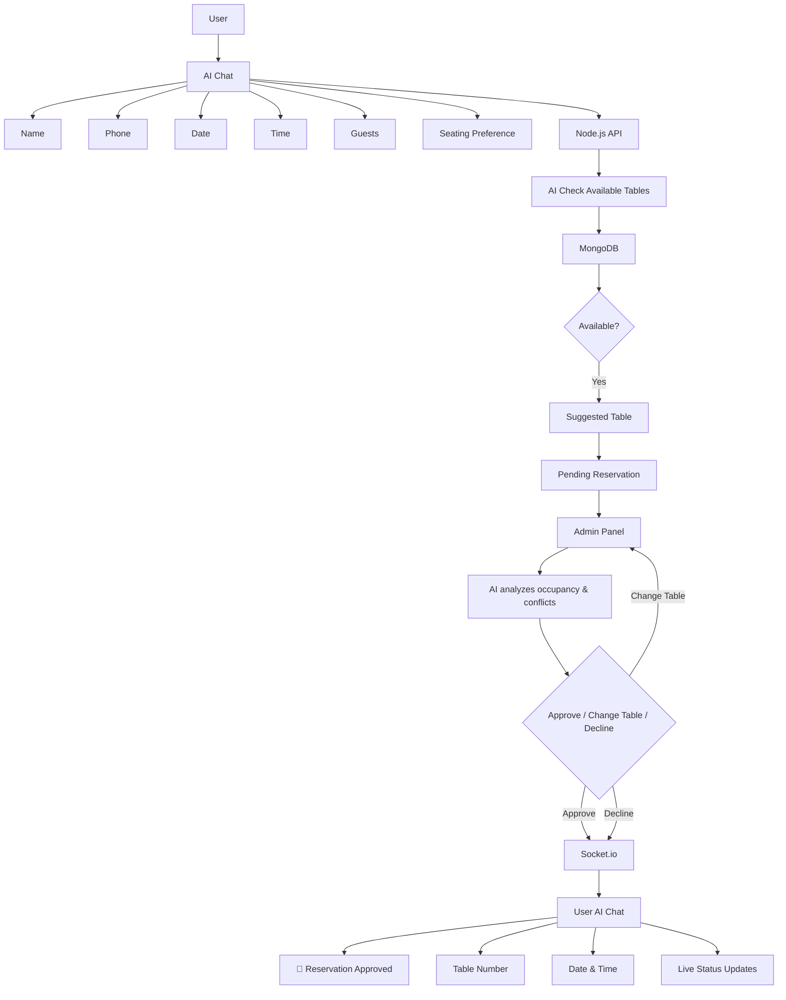

# AI Restaurant Management System

An advanced, full-stack AI-powered restaurant management system designed to handle customer reservations, seating, staff management, orders, and real-time updates seamlessly.

## Features

- **AI Reservation Agent:** Customers can book reservations via an AI chat interface.
- **Smart Table Allocation:** AI analyzes occupancy and conflicts to suggest available tables.
- **Admin Dashboard:** Manage reservations, tables, and staff in real-time.
- **Live Status Updates:** Customers receive real-time notifications about their reservation status.
- **Interactive UI:** Beautiful, animated frontend built with React, Framer Motion, and GSAP.

---

## Tech Stack

### Frontend
- **Framework:** React 19 + Vite + TypeScript
- **Styling & UI:** Tailwind CSS v4, Lucide React, react-icons
- **Animations & 3D:** Framer Motion, GSAP, Three.js, React Three Fiber/Drei, Lottie React, react-spring
- **Routing:** React Router DOM
- **Data Visualization:** Recharts, React CountUp
- **Forms & State:** React Hook Form
- **Real-Time Communication:** Socket.io-client
- **Exports:** jsPDF, xlsx
- **Voice/AI Integration:** Ultravox Client

### Backend
- **Runtime & Framework:** Node.js, Express.js
- **Database:** MongoDB (Mongoose)
- **AI & LLMs:** LangChain, LangGraph, Groq
- **Real-Time Communication:** Socket.io
- **Voice/Audio:** Deepgram SDK, Ultravox Client
- **Authentication & Security:** JWT (jsonwebtoken), bcryptjs, CORS
- **File Uploads:** Multer
- **Messaging & Notifications:** Twilio (SMS), Nodemailer (Email)
- **Validation:** Zod

---

## Reservation Flow Diagram



## Getting Started

### Prerequisites
- Node.js installed
- MongoDB URI
- Environment variables configured (Groq, Twilio, Deepgram, JWT Secret, etc.)

### Installation

1. **Clone the repository:**
   ```bash
   git clone <repository-url>
   ```

2. **Install Backend Dependencies:**
   ```bash
   cd backend
   npm install
   ```

3. **Install Frontend Dependencies:**
   ```bash
   cd frontend
   npm install
   ```

4. **Run the Backend:**
   ```bash
   cd backend
   npm run dev
   ```

5. **Run the Frontend:**
   ```bash
   cd frontend
   npm run dev
   ```